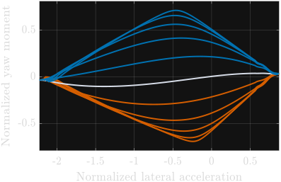
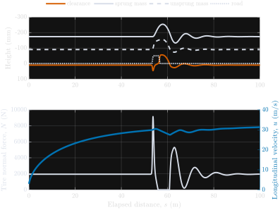

  

<!-- # Hey there, I'm Richie! -->

I'm a **controls engineer, private race engineer, and PhD student** at the University of the Witwatersrand. My work focuses on applying **optimal control and numerical optimization** to develop tools for motorsport performance.

Motorsport is my primary application domain, but my interests extend to the broader fields of control and optimization. The methods I work with can also be applied to dynamic systems across many engineering disciplines and industries.

I hold a BSc in Mechanical Engineering from the University of South Florida and an MSc in Motorsport Engineering from Oxford Brookes University. I've worked with sportscar teams competing in **IMSA and SRO**, across **GT3 and GT4** racing. My experience has taken me from tire work through data and performance engineering to race engineering.

I'm currently affiliated with **General Motors**, who sponsors my PhD.

---

## Research & Engineering Interests

- **Optimal control and numerical optimization**
- **Model predictive control**
- **Vehicle dynamics and tire modeling**
- **Trajectory and performance optimization**
- **Computational engineering and simulation**

## Selected Projects

I use this space to share simplified implementations of techniques from my research and publications, along with engineering tools and utilities. The projects below illustrate some of the problems I enjoy working on.

### [Yaw Moment Diagrams](https://github.com/richieleytongt/yaw_moment_diagrams)

Calculating vehicle yaw moment diagrams via optimal control for vehicles accelerating on three-dimensional roads.

  

**Topics:** Vehicle dynamics · Tire modeling · Optimal control

### [Quarter-Car Suspension Optimization](https://github.com/richieleytongt/qc_bumps)

A quarter-car model that traverses a road bump, including tire contact loss, with suspension parameters optimized as part of the problem.

  

**Topics:** Quarter-car modeling · Suspension dynamics · Numerical optimization

### [H₂ Ride Optimization](https://github.com/richieleytongt/H2RideOptimization)

Minimizing the H₂ norm of a suspension model to improve road-holding performance.

**Topics:** Control theory · H₂ optimization · Suspension dynamics

## Publications & Research

For my publications and research contributions, visit my [Google Scholar profile](https://scholar.google.com/citations?user=HKds3OUAAAAJ&hl=en&oi=ao).

## Technical Toolkit

  
  
  

## Connect

I'm always happy to connect with people working in controls, optimization, vehicle dynamics, and motorsport.

<!-- ## Collaboration and open projects -->